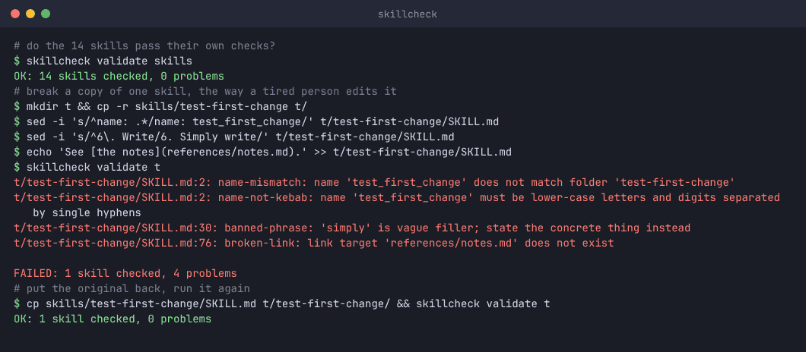
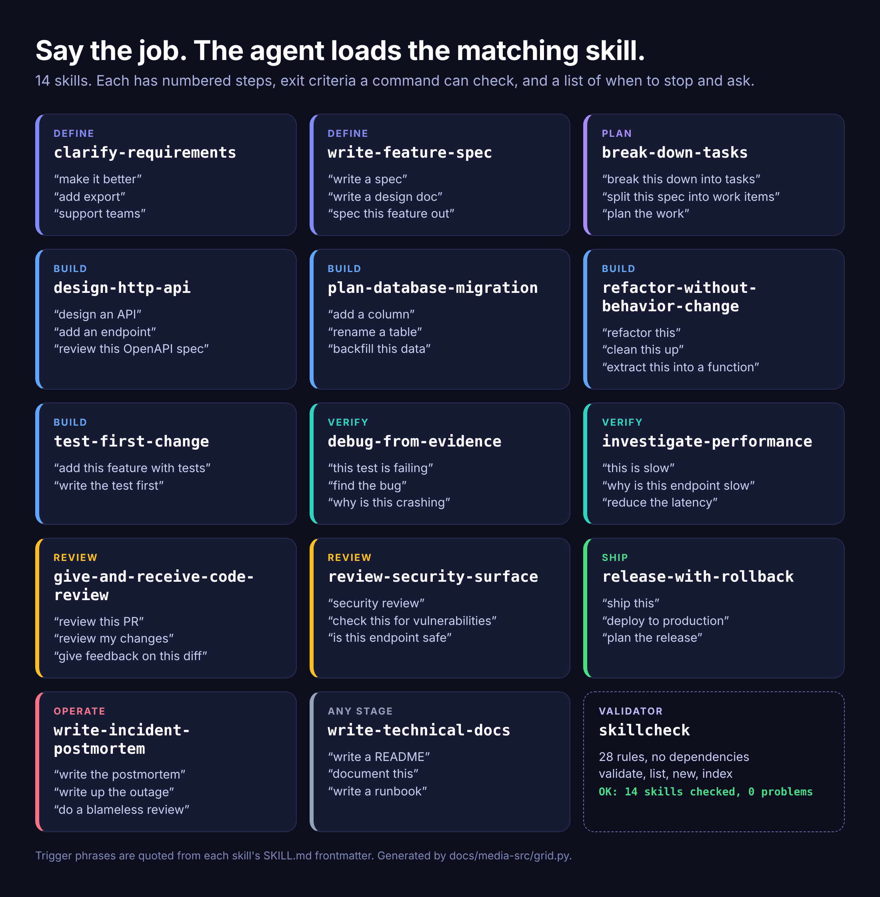
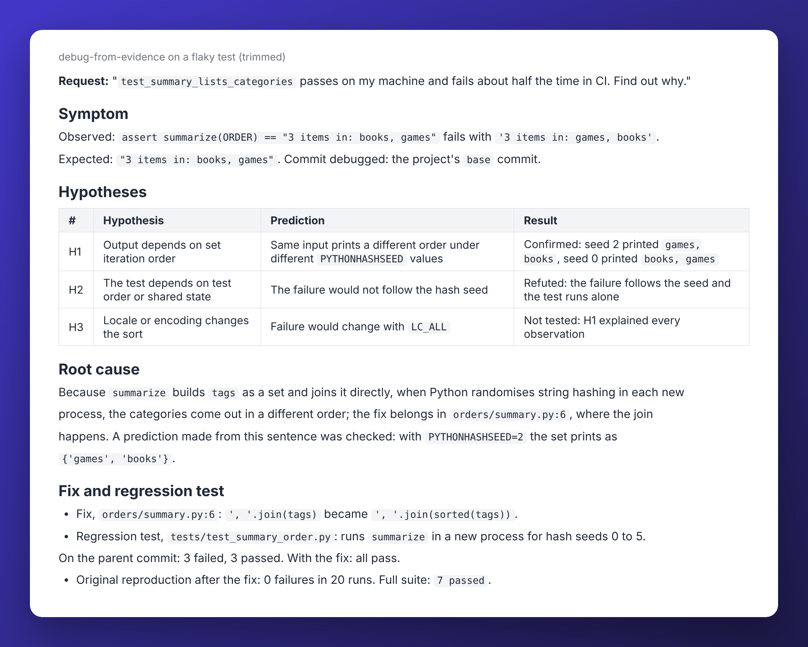
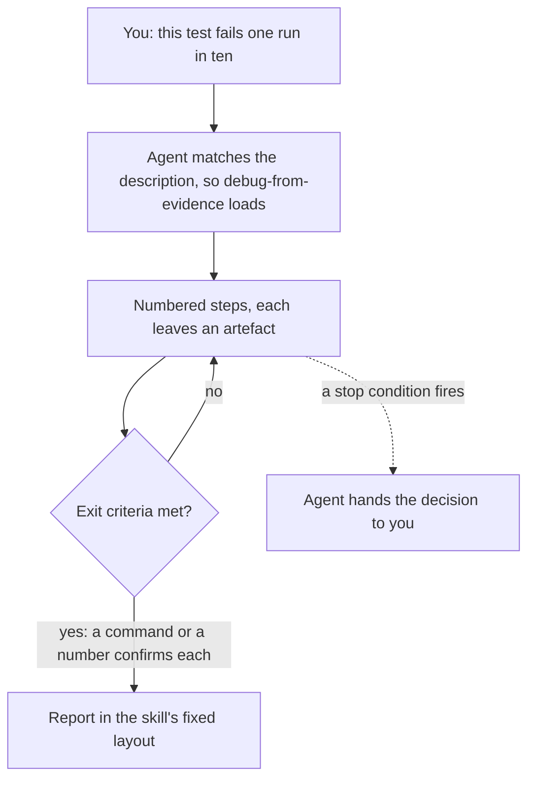

<p align="center"></p>
<h1 align="center">Engineering Skills Pack</h1>
<p align="center"><b>Fourteen checkable workflows that make an AI coding agent debug, review, migrate and ship like a careful senior engineer.</b></p>
<p align="center"><a href="https://github.com/FinnTech3/engineering-skills-pack/actions/workflows/ci.yml"></a>  </p>
<p align="center"></p>
<p align="center"><sub>Real output, 19 seconds. It breaks a copy of one skill in a temp folder and the validator names the file, line and rule.</sub></p>

## The straight answer

- **What it does.** Fourteen `SKILL.md` files, one per job: clarify, spec, plan, test first, refactor, design an API,
  migrate a database, debug, chase a slow path, review, security review, release, postmortem, docs. Your agent loads the
  one that matches your request and works numbered steps that end in exit criteria a command or a number can check.
  `skillcheck`, the validator in this repo, keeps all fourteen in that shape.
- **What it needs.** Nothing to install to use the skills: copy a folder. The validator needs Python 3.10 or newer and no
  packages. The agent uses the git, test runner and linter you already have.
- **What it will not do.** Write your code, know your stack's conventions, or sign off a release, a migration or a security
  finding for you. No benchmark here shows it changes an agent's output ([more](#what-it-wont-do)).

## See it work

<p align="center"></p>

The 14 skills and the phrases that load them. Every phrase is quoted from that skill's own frontmatter by
[`docs/media-src/grid.py`](docs/media-src/grid.py); I typed none of them.

<p align="center"></p>

A real run of `debug-from-evidence` on a test that fails about half the time in CI, trimmed to four sections
([full report](agensi/engineering-workflow-skills/examples/debug-from-evidence-worked-example.md)). Notice that every
hypothesis carries a prediction, and that the regression test fails 3 of 6 hash seeds on the old code.

## Run it in 60 seconds

```bash
git clone https://github.com/FinnTech3/engineering-skills-pack
cd engineering-skills-pack
pip install -e .              # the validator, no dependencies
skillcheck validate skills    # OK: 14 skills checked, 0 problems
skillcheck list               # every skill, its length and its trigger
```

## Use it with your agent

1. Copy the folders you want into the directory your agent reads skills from (check its documentation for the location):
   `cp -r skills/debug-from-evidence /path/to/your/agent/skills/`, or `cp -r skills/* ...` for all of them.
2. Ask for the job in your own words: "this test fails one run in ten, find out why".
3. The agent reads every skill's name and description, and loads the matching file.
4. It works the numbered steps. Each step leaves something you can point at: a command output, a file, a number.
5. It ends with the exit criteria as a checklist, each marked met or not met with a line of evidence, and it stops and asks
   you when a stop condition fires.

Each skill is self-contained, and the validator rejects any link that points outside its folder. The pack is also packaged
for Agensi as "Engineering Workflow Skills" ([listing copy](agensi/LISTING.md)).

## What it costs you

| Cost | What you pay |
|---|---|
| Install | Copy folders. Nothing runs at install time. |
| Context | The agent keeps all 14 descriptions in view: 4,438 characters in total. A skill loads only when it matches. The files run from 68 to 83 lines. |
| Permissions | The skills tell the agent to read your code and run your own git, tests and linters, and to stop and ask before anything touching production, credentials or data. |
| Network | None. The skills ask for none, and the validator reads local files only. |

## How it works



Every `SKILL.md` has frontmatter with a `name` and a `description`, then seven sections in a fixed order: `Purpose`,
`Inputs needed`, `Steps`, `Output`, `Exit criteria` (checkboxes a command, a number or a file can confirm), `Failure modes`
and `When to stop and ask`.

The `description` decides whether a skill is ever used, so each one says when to use it and when not to. From
`debug-from-evidence`: "Do not use when the cause is already known (use `test-first-change`) or for slowness (use
`investigate-performance`)." Three skills carry a `references/` folder for material too long for the main file.

<details>
<summary>All 14 skills with their purpose line</summary>

The purposes are taken from each skill's `Purpose` section, and a test keeps this table in sync with them.
[INDEX.md](INDEX.md) adds the full trigger description of each skill.

| Stage | Skill | Purpose |
|---|---|---|
| Define | [`clarify-requirements`](skills/clarify-requirements/SKILL.md) | Turn a vague request into confirmed facts, labelled assumptions and at most five blocking questions. |
| Define | [`write-feature-spec`](skills/write-feature-spec/SKILL.md) | Produce a spec that a different engineer can implement and test without asking the author a question. |
| Plan | [`break-down-tasks`](skills/break-down-tasks/SKILL.md) | Split a spec into small, ordered, independently verifiable tasks, each tied to the requirements it delivers. |
| Build | [`test-first-change`](skills/test-first-change/SKILL.md) | Change behavior in small steps where every step is driven by a test that was seen failing first. |
| Build | [`refactor-without-behavior-change`](skills/refactor-without-behavior-change/SKILL.md) | Restructure code in small mechanical steps, with tests bracketing every step, so that behavior is provably unchanged. |
| Build | [`design-http-api`](skills/design-http-api/SKILL.md) | Define an HTTP contract that clients can depend on, and prove with checks that later changes do not break it. |
| Build | [`plan-database-migration`](skills/plan-database-migration/SKILL.md) | Change a live schema or its data in reversible steps, with measured lock time and a tested rollback. |
| Verify | [`debug-from-evidence`](skills/debug-from-evidence/SKILL.md) | Find the root cause of a defect by observation, prove it with a prediction, and fix it with a regression test. |
| Verify | [`investigate-performance`](skills/investigate-performance/SKILL.md) | Locate the dominant cost with measurement, change one thing at a time, and prove the gain against a recorded baseline. |
| Review | [`give-and-receive-code-review`](skills/give-and-receive-code-review/SKILL.md) | Catch defects and maintenance costs before merge, and resolve feedback quickly without losing technical accuracy. |
| Review | [`review-security-surface`](skills/review-security-surface/SKILL.md) | Find exploitable weaknesses by tracing untrusted data to dangerous operations, with a scenario, a fix and a test each. |
| Ship | [`release-with-rollback`](skills/release-with-rollback/SKILL.md) | Ship a change in stages with pre-agreed abort thresholds, and be able to reverse it within a stated time. |
| Operate | [`write-incident-postmortem`](skills/write-incident-postmortem/SKILL.md) | Record what happened, why the system allowed it, and which checkable actions will prevent a repeat, without blame. |
| Any stage | [`write-technical-docs`](skills/write-technical-docs/SKILL.md) | Write a document a named reader can follow to finish one task, with every command checked against the running system. |

</details>

## Why it's built this way

- **One fixed shape.** Seven sections in a fixed order, so you can skim any skill the same way and a program can check it.
- **Exit criteria you can run.** "Tests pass" is a criterion. "Code is clean" is not. A skill that cannot say how it ends
  is advice, and agents skip advice.
- **Each description names its neighbour.** A failing test could be `debug-from-evidence` or `test-first-change`; the
  exclusion in the description is what routes the agent.
- **A validator, with no dependencies.** Fourteen hand-written files drift. `skillcheck` has 28 rules and runs in
  well under a second. Its frontmatter parser rejects what stricter YAML loaders reject, such as an unquoted `: `, so a
  file that passes here loads elsewhere.
- **A line cap.** A `SKILL.md` over 120 lines fails. A skill that does not fit is two skills.

## Validate your own skills

`skillcheck` works on any folder of skills, not only this pack, and does not use the network.

```bash
skillcheck new rotate-api-keys      # creates skills/rotate-api-keys/SKILL.md from the template
skillcheck validate skills          # fails on every TODO you have not replaced
skillcheck index                    # refresh INDEX.md
```

Exit codes: `0` ok, `1` problems found, `2` usage error. [docs/validator.md](docs/validator.md) has every command, flag and
all 28 rules, with what makes each one fail.

## What it won't do

- **Tell you a skill is right.** The validator checks structure, wording and links. Whether a skill is correct or useful is
  a human call.
- **Prove it makes your agent better.** The skills are reviewed text. No benchmark in this repository measures how much they
  change an agent's output.
- **Know your numbers.** The thresholds inside the skills (400 changed lines, 5% noise, one hour of bake time) are defaults
  taken from common practice. Change them to fit your team.
- **Check everything.** Link checks cover relative file links, not anchors or external URLs. Headings are recognised in ATX
  form (`## Title`) only. The banned phrase list is English only and fixed in the source; there is no configuration file.
  Only folders directly under the skills root count as skills; names starting with `.` or `_` are ignored.

## Develop / verify

```bash
python -m venv .venv && . .venv/bin/activate
pip install -e ".[dev]"
pytest -q                     # 372 offline tests, no network, about 2 seconds
ruff check .
skillcheck validate skills
skillcheck index --check
python3 tools/agensi_build.py agensi/engineering-workflow-skills --with skills   # checks the package, writes dist/
```

The tests also check this repository: the shipped skills must pass `skillcheck validate`, `INDEX.md` must match what
`skillcheck index` generates, and the skills table here and the rules table in `docs/validator.md` must match the code.
The pre-upload checklist is [tools/AGENSI_CHECKLIST.md](tools/AGENSI_CHECKLIST.md); the trigger prompts in
[agensi/TRIGGER_TESTS.md](agensi/TRIGGER_TESTS.md) have not been run in an agent yet.

To regenerate the images and the clip, run `docs/media-src/build-media.sh`. It needs `skillcheck` on your path, Pillow,
Node with Playwright, and ffmpeg. The clip runs the real validator, and the grid is read from the real `SKILL.md` files.

## Finn's take

A skill that says "write good tests" is a mood. A skill that says the new test must fail first, and that the failure must
describe the missing behaviour rather than an import error, is a procedure you can check afterwards. That is the whole bet
of this pack: every step leaves something you can point at, every exit criterion is something a command can confirm, and
every skill says when to stop and hand the decision to you. I wrote the validator because fourteen hand-written files
drift, and a stray "as needed" is where an agent starts improvising. I can't prove the skills make an agent better, and I'd
rather say so than invent a chart. What I can prove is that every skill has the same shape, and the tests pin that down.

Built by FinnTech3.

## Licence

MIT, see [LICENSE](LICENSE). The badge and clone URL assume the repo is published as `FinnTech3/engineering-skills-pack`.
